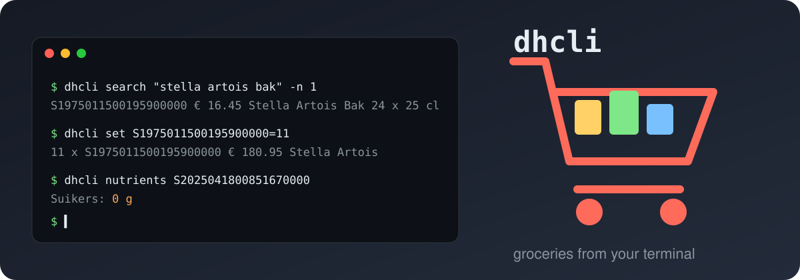

# dhcli



`dhcli` is an unofficial command-line client for [delhaize.be](https://www.delhaize.be). It searches products, shows ingredient lists and nutrition facts, and fills your Delhaize cart without clicking through the site. One Python file, standard library only.

dhcli is not affiliated with Delhaize. It talks to the same GraphQL API the website uses, so a change on their side can break it.

## Commands

| Command | What it does | Login needed |
| --- | --- | --- |
| `dhcli search QUERY [-n N]` | Lists matching products with code, price and pack size | no |
| `dhcli ingredients CODE ...` | Prints the ingredient list of one or more products | no |
| `dhcli nutrients CODE ...` | Prints nutrition facts per 100 g or 100 ml | no |
| `dhcli cart` | Lists your cart with line totals and the total at list price | yes |
| `dhcli set CODE=QTY ...` | Sets absolute quantities in your cart; `0` removes a product | yes |

Product codes come from `search` (the first column).

## Install

```sh
uv tool install git+https://github.com/Triver1/delhaize-cli
# or
pipx install git+https://github.com/Triver1/delhaize-cli
```

Working on the code? Install from a clone in editable mode, so your edits apply without reinstalling:

```sh
git clone https://github.com/Triver1/delhaize-cli && cd delhaize-cli
uv tool install -e .
```

Requires Python 3.9 or newer.

## Log in (cart commands only)

`cart` and `set` act on your own Delhaize cart, so they send your session cookie with each request.

1. Log in on delhaize.be in your browser.
2. Open DevTools, go to the Network tab and reload the page.
3. Click any request to `delhaize.be/api/v1/` and copy the value of the `Cookie` request header.
4. Add it to `~/.zshrc` (or your shell's equivalent) and open a new terminal:

```sh
export DELHAIZE_COOKIE='...'
```

The cookie gives full access to your Delhaize account: keep it out of git, chats and screenshots. It stops working when you log out of delhaize.be; copy a fresh one then.

## Usage

### Find products

```console
$ dhcli search "stella artois bak" -n 2
S1975011500195900000  € 16.45  Stella Artois Blond Bier | Pils | 5,2% Alc. | Bak 24 x 25 cl
S2023010500670640099  € 20.45  Stella Artois Blond Bier | Pils | 5,2% Alc. | Bak 24 x 33 cl
```

Out-of-stock products end with `OUT OF STOCK`.

### Ingredients and nutrition facts

```console
$ dhcli ingredients S2022072800600560098
Lay's Chips | Pickles (S2022072800600560098)
Aardappelen, plantaardige oliën (zonnebloem, koolzaad, in wisselende hoeveelheden), piccalillysmaak [aroma's, suiker, kaliumchloride, specerijen, zout, zuurteregelaars (citroenzuur, appelzuur)], antioxidanten (extracten van rozemarijn, ascorbinezuur, tocoferolrijk extract, citroenzuur).

$ dhcli nutrients S2025041800851670000
Monster Energy Lando Norris | Zero Sugar (S2025041800851670000)
  Per: Niet Bereid 100 mlt
  Energie: 9 KJ
  Kilocalorieën: 2 KCAL
  Koolhydraten waarvan: 0.7 g
  Suikers: 0 g
  ...
```

Both take several codes at once, which makes questions like "which of these energy drinks contain sugar?" a one-liner.

### Read your cart

```console
$ dhcli cart
  11 x S1975011500195900000  € 180.95  Stella Artois Blond Bier | Pils | 5,2% Alc. | Bak 24 x 25 cl
   8 x S2025050500859270000  €  18.32  Lay's Chips | Paprika 300 gr
...
548 items, €1839.91 at list price (promotions apply at checkout)
```

### Change quantities

`set` takes absolute quantities, not increments. dhcli reads the cart, sends only the differences in one request and prints the updated cart.

```sh
dhcli set S1975011500195900000=11 S2025050500859270000=8   # set two products
dhcli set S2022072800600560098=0                           # remove one
```

For a long list, keep `CODE=QTY` lines in a file:

```sh
dhcli set $(cat shopping-list.txt)
```

Checkout, the delivery or collect slot and payment stay on the website or the app.

## How it works

Every command is one or two POST requests to `https://www.delhaize.be/api/v1/`, the GraphQL endpoint behind the website:

| Command | GraphQL operation |
| --- | --- |
| `search` | `GetProductSearch` (`productSearchV2`) |
| `ingredients`, `nutrients` | `ProductDetails` (`wsNutriFactData`) |
| `cart` | `Cart` |
| `set` | `Cart`, then `MiniBasketUpdateCartEntryQuantity` with quantity deltas |

The cart total that the API returns stays stale until the cart page recalculates it, so `dhcli cart` adds up the lines at list price instead. Promotions such as "2 for €9.99" only show up at checkout.

## Limitations

- Product names and nutrition labels come back in Dutch (`lang: nl` is fixed).
- Delhaize sits behind bot protection. Normal use works, but unusual requests (like GraphQL introspection) get an `Access Denied` page. Don't hammer the API.
- The API is undocumented and can change without notice.

## Development

```sh
python3 test_delhaize.py
```

The test covers the quantity-delta logic behind `set`. Everything else lives in `delhaize.py`.
